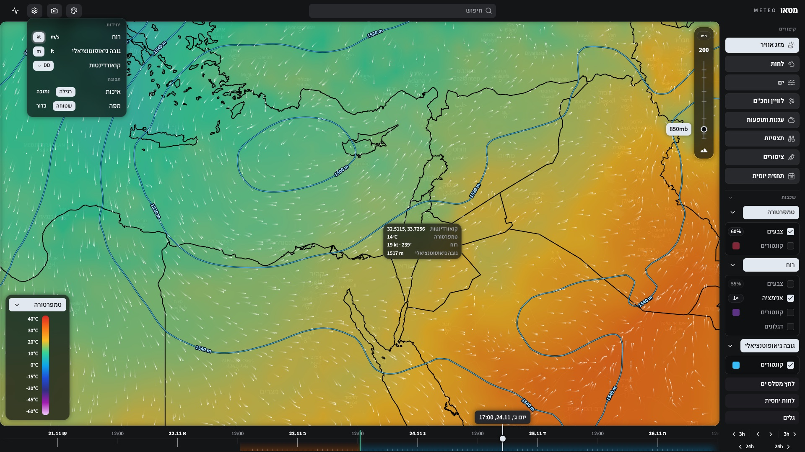
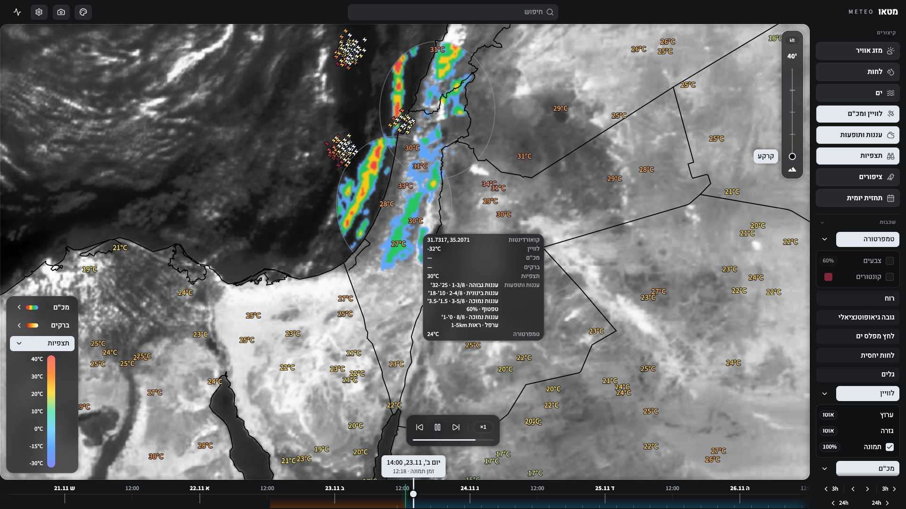
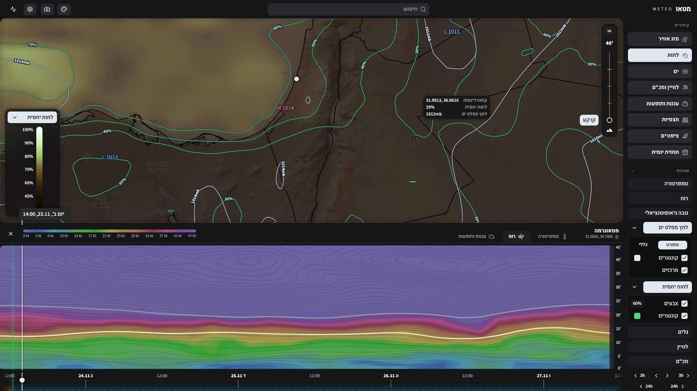
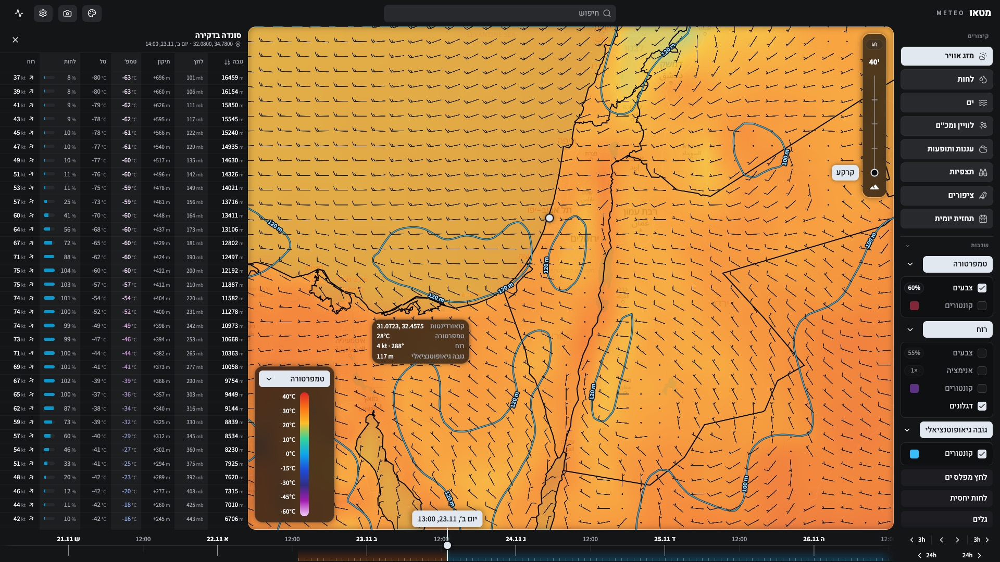

<div align="center">


# Meteo

A meteorological forecasting app, built with Angular 22 and MapLibre, running fully offline.




|  |  |  |
|:---:|:---:|:---:|

</div>

## What went into it

- **Looks apart from layers**: any layer can be drawn as colors, contours, animation, barbs or arrows.
- **Shortcuts**: ready-made layer combinations in one click.
- **Hover on hidden layers**: read values over an untouched satellite image.
- **Loops in sync**: satellite, radar, lightning and observations play together at their own pace.
- **GPU wind trails**: a WebGL2 layer of its own, colored to match the basemap.
- **Zoomable time bar**: from minutes to years, with a live mode.
- **Level rail**: heights in feet or pressure levels in millibars.
- **Point tools**: meteogram, sounding table and distance measuring from a right-click.
- **Search**: places, or coordinates in DD, DMS, UTM or a local grid.
- **Smooth on weak PCs**: heavy work in a Web Worker, a low-quality mode and a performance HUD.
- **Fully offline**: every basemap, font and icon is self-hosted.
- **Easy to extend**: a new layer is one small file; MapLibre stays inside `engine/`.

## Running it locally

```sh
npm install
npm run ecmwf:fetch    # sample ECMWF data (~290 MB, gitignored)
npm run basemap:fetch  # basemap tiles
npm run start:fixtures # http://localhost:9993 on sample data
```
